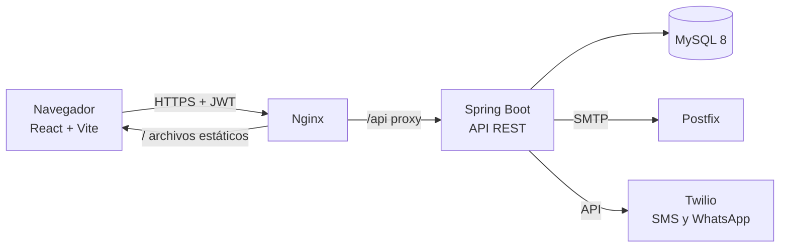
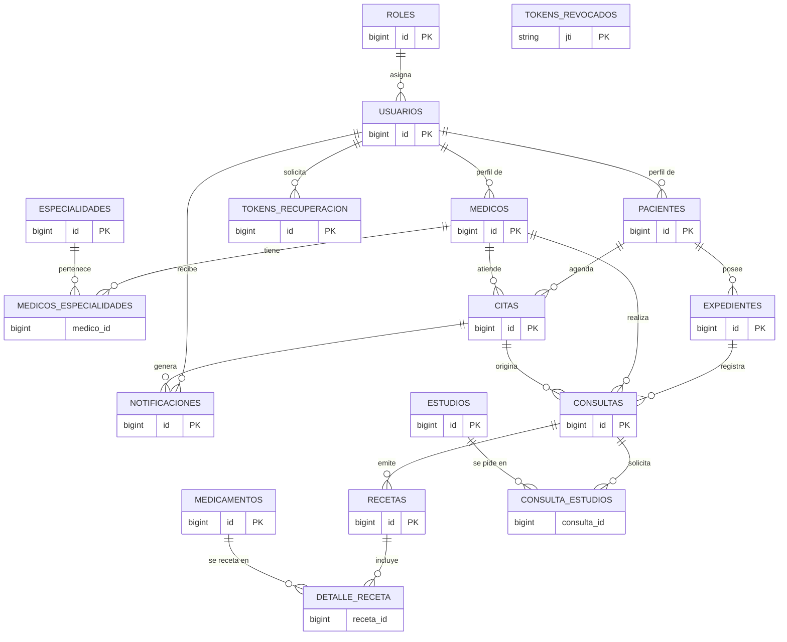

# VITACARE – Sistema de Gestión de Clínica

Aplicación web full stack para administrar una clínica médica: usuarios, médicos, pacientes, citas, expedientes clínicos, consultas, recetas, estudios y notificaciones al paciente por correo, SMS y WhatsApp.

> **Equipo {{12}}:** {{velasco martinez zeferino}} y {{Evelin Aleida}}

## Enlaces del proyecto

| Recurso | Enlace |
|---|---|
| Aplicación desplegada (HTTPS) | {{URL_HTTPS_DEL_PROYECTO}} |
| URL base de la API | {{URL_HTTPS_DEL_PROYECTO}}/api |
| Prototipo en Figma | {{LINK_FIGMA}} |
| Tablero de GitHub Projects | {{LINK_GITHUB_PROJECTS}} |
| Diagrama entidad-relación | [Ver en este README](#modelo-de-datos) · [PDF](docs/diagrama-er.pdf) |

## Contenido

1. [Funcionalidades por rol](#funcionalidades-por-rol)
2. [Tecnologías](#tecnologías)
3. [Arquitectura](#arquitectura)
4. [Modelo de datos](#modelo-de-datos)
5. [Instalación y ejecución local](#instalación-y-ejecución-local)
6. [Credenciales de prueba](#credenciales-de-prueba)
7. [Configuración](#configuración)
8. [API REST](#api-rest)
9. [Seguridad](#seguridad)
10. [Comunicación con el usuario](#comunicación-con-el-usuario)
11. [Pruebas de API con Bruno](#pruebas-de-api-con-bruno)
12. [Diseño en Figma](#diseño-en-figma)
13. [Despliegue en VPS](#despliegue-en-vps)
14. [Estructura del repositorio](#estructura-del-repositorio)

## Funcionalidades por rol

El sistema maneja tres niveles de acceso. Los permisos se validan en el backend (Spring Security) y también se reflejan en el frontend con rutas protegidas.

| Rol | Qué puede hacer |
|---|---|
| **ADMIN** (administrador) | Acceso total: gestión de usuarios, médicos y pacientes (alta, edición y baja), citas, expedientes y panel general. |
| **DOCTOR** (médico) | Consulta pacientes, gestiona sus citas y trabaja con expedientes y consultas. |
| **PATIENT** (paciente) | Accede únicamente a sus propios datos: sus citas, su expediente y su perfil. |

Funciones generales: inicio de sesión con correo y contraseña, registro de pacientes, recuperación de contraseña, perfil de usuario, listados con paginación y búsqueda desde el servidor, validaciones visibles bajo cada campo, modales de confirmación, diseño responsivo y estados de carga.

## Tecnologías

| Capa | Tecnología |
|---|---|
| Backend | Java 21, Spring Boot 3.5, Spring Web, Spring Data JPA (Hibernate), Spring Security, JWT (jjwt), Bean Validation, Maven |
| Base de datos | MySQL 8 (no MariaDB), Flyway para las migraciones |
| Frontend | React, Vite, React Router, Axios, JavaScript, HTML y CSS |
| Comunicación | JavaMailSender + Postfix (correo), Twilio (SMS y WhatsApp) |
| Herramientas | Git y GitHub, GitHub Projects, Bruno (pruebas de API), Figma (diseño) |
| Despliegue | VPS propio, Nginx, systemd, Let's Encrypt (Certbot) |

## Arquitectura



El backend expone una API REST con DTOs (las entidades JPA nunca se exponen directamente). El frontend la consume con Axios y envía el token JWT en el encabezado `Authorization` de cada petición protegida.

## Modelo de datos

El esquema tiene **17 tablas** relacionadas y se crea y versiona con Flyway. Hay tres relaciones de muchos a muchos (N:M) resueltas con tablas intermedias:

- `medicos` ↔ `especialidades` mediante `medicos_especialidades`
- `consultas` ↔ `estudios` mediante `consulta_estudios`
- `recetas` ↔ `medicamentos` mediante `detalle_receta`



El diagrama muestra solo claves y relaciones; el detalle de cada columna está en la migración [`V1__esquema_inicial.sql`](backend/src/main/resources/db/migration/V1__esquema_inicial.sql).

### Versionamiento y datos de prueba

- Las migraciones están en `backend/src/main/resources/db/migration/`. Flyway las aplica automáticamente al iniciar el backend.
- Hibernate usa `ddl-auto=validate`: solo comprueba que las entidades coincidan con el esquema, nunca lo modifica.
- Al arrancar con la base vacía, `DatosInicialesRunner` carga los datos de prueba (un administrador, médicos y pacientes de ejemplo).
- Respaldo SQL de la base de datos: [`backend/vitacare_db_backup.sql`](backend/vitacare_db_backup.sql).

## Instalación y ejecución local

### Requisitos

- Java 21 y Maven
- MySQL 8 (no se acepta MariaDB)
- Node.js 20 o superior y npm
- Git

### 1. Clonar el repositorio

```powershell
git clone {{URL_DEL_REPOSITORIO}}
cd ClinicaVITACARE
```

### 2. Crear la base de datos

Entra a MySQL y ejecuta (cambia la contraseña):

```sql
CREATE DATABASE vitacare_db CHARACTER SET utf8mb4 COLLATE utf8mb4_unicode_ci;
CREATE USER 'vitacare_app'@'localhost' IDENTIFIED BY 'CAMBIA_ESTA_CONTRASENA';
GRANT ALL PRIVILEGES ON vitacare_db.* TO 'vitacare_app'@'localhost';
FLUSH PRIVILEGES;
```

No hace falta crear tablas: Flyway las genera al iniciar el backend.

### 3. Configurar y ejecutar el backend

```powershell
cd backend
copy src\main\resources\application.properties.example src\main\resources\application.properties
notepad src\main\resources\application.properties
```

Rellena los valores (ver [Configuración](#configuración)) y arranca:

```powershell
mvn spring-boot:run
```

La API queda en `http://localhost:8080/api`.

### 4. Ejecutar el frontend

En otra terminal:

```powershell
cd frontend
npm install
npm run dev
```

La aplicación queda en `http://localhost:5174`. Si el backend no está en `http://localhost:8080/api`, crea `frontend/.env` con `VITE_API_URL=<url de tu API>`.

> El puerto del frontend (5174) debe coincidir con `cors.origenes-permitidos` del backend; si no, el navegador bloqueará las peticiones por CORS.

## Credenciales de prueba

Datos cargados automáticamente en el primer arranque. Son solo para pruebas y evaluación.

| Rol | Correo | Contraseña |
|---|---|---|
| Administrador (evaluación) | `admin@vitacare.com` | `Admin123!` |
| Médico | `doctor1@vitacare.com` (hasta `doctor3`) | `Doctor123!` |
| Paciente | `paciente1@vitacare.com` (hasta `paciente10`) | `Paciente123!` |

## Configuración

Las variables sensibles viven en `backend/src/main/resources/application.properties`, que **no se sube al repositorio** (está en `.gitignore`). El archivo `application.properties.example` lista todas las necesarias sin valores reales.

| Propiedad | Para qué sirve |
|---|---|
| `spring.datasource.url` / `username` / `password` | Conexión a MySQL |
| `jwt.secreto` | Clave para firmar los JWT (mínimo 32 caracteres) |
| `cors.origenes-permitidos` | Origen del frontend autorizado (por ejemplo `http://localhost:5174`) |
| `spring.mail.host` / `port` | Servidor SMTP (Postfix local en el VPS) |
| `notificaciones.correo.remitente` | Remitente de los correos (debe ser de tu dominio) |
| `notificaciones.prefijo-telefono` / `prefijo-whatsapp` | Prefijo de país para teléfonos de 10 dígitos |
| `twilio.account-sid` / `auth-token` | Credenciales de Twilio |
| `twilio.numero-sms` / `numero-whatsapp` | Números de origen para SMS y WhatsApp |

## API REST

- **URL base local:** `http://localhost:8080/api`
- **URL base en producción:** {{URL_HTTPS_DEL_PROYECTO}}/api
- **Autenticación:** JWT. Después de iniciar sesión, envía el token en cada petición protegida:

```http
Authorization: Bearer <token>
```

| Recurso | Descripción | Acceso |
|---|---|---|
| `POST /autenticacion/login` | Inicio de sesión; devuelve el token | Público |
| `POST /autenticacion/registro` | Registro de un paciente | Público |
| `POST /autenticacion/logout` | Cierra sesión e invalida el token | Autenticado |
| `POST /autenticacion/recuperar-contrasena` | Envía un enlace de recuperación por correo | Público |
| `POST /autenticacion/restablecer-contrasena` | Crea una contraseña nueva con el enlace recibido | Público |
| `/pacientes` | Pacientes | Lectura: ADMIN y DOCTOR. Escritura: ADMIN |
| `/medicos` | Médicos y directorio | Escritura: solo ADMIN |
| `/usuarios` | Usuarios del sistema | Solo ADMIN |
| `/citas` | Citas (incluye `PATCH /citas/{id}/estado`) | ADMIN, DOCTOR y PATIENT según sus datos |
| `/expedientes` | Expedientes y consultas | Según rol |
| `/dashboard` | Resumen del panel | Autenticado |

Los listados devuelven resultados paginados desde el servidor y aceptan filtros como parámetros de la consulta (`page`, `size`, `search`).

### Errores

Todas las respuestas de error son JSON con el código HTTP correcto, manejadas con `@ControllerAdvice`:

| Código | Cuándo ocurre |
|---|---|
| 400 | Datos inválidos (Bean Validation) |
| 401 | Sin token, token inválido o credenciales incorrectas |
| 403 | El rol no tiene permiso |
| 404 | Recurso no encontrado |
| 409 | Conflicto (por ejemplo, correo ya registrado) |
| 422 | Regla de negocio no cumplida |
| 500 | Error interno |

## Seguridad

- Contraseñas almacenadas con **BCrypt**, nunca en texto plano.
- Requisitos de contraseña: mínimo 8 caracteres, una mayúscula, un número y un carácter especial. Se validan en el frontend (bajo el campo) y en el backend (Bean Validation).
- Autenticación con JWT y autorización por rol con `@PreAuthorize` y Spring Security. Al cerrar sesión, el token se invalida en el servidor.
- Los enlaces de recuperación de contraseña son de un solo uso, caducan en 30 minutos y solo se guarda su hash.
- Secretos y credenciales fuera del repositorio (`application.properties` ignorado por Git).
- Respuestas de la API con DTOs: no se exponen entidades JPA.

## Comunicación con el usuario

Cuando se crea una cita o cambia su estado, el paciente recibe un aviso por tres canales. El envío ocurre en segundo plano y un fallo nunca interrumpe la operación.

| Canal | Cómo funciona |
|---|---|
| Correo electrónico | `JavaMailSender` hacia **Postfix** instalado en el VPS, con registros SPF y DKIM |
| SMS | API de Twilio |
| WhatsApp | API de Twilio |

La recuperación de contraseña también usa el correo. Cada intento queda registrado en la tabla `notificaciones` con su estado (`ENVIADO` o `FALLIDO`) y el motivo del error si lo hubo.

## Pruebas de API con Bruno

La colección está en la carpeta [`pruebas-API/`](pruebas-API/). Para usarla, abre Bruno, elige **Open Collection** y selecciona esa carpeta. Incluye:

- Inicio de sesión y obtención del token JWT
- Uso del token en peticiones protegidas
- Casos de error a propósito (acceso denegado, datos inválidos y recurso no encontrado)

## Diseño en Figma

- Prototipo navegable con las pantallas principales de cada rol: {{LINK_FIGMA}}
- Paleta de colores propia del proyecto y su justificación: {{DESCRIBIR_PALETA}}
- Logo original diseñado por el equipo: {{RUTA_O_IMAGEN_DEL_LOGO}}

## Despliegue en VPS

El proyecto corre completo en un VPS propio:

- **Backend:** JAR de Spring Boot ejecutado como servicio con `systemd`.
- **Frontend:** build estático (`npm run build`) servido por Nginx.
- **Base de datos:** MySQL 8 en el mismo servidor.
- **HTTPS:** certificado gratuito de Let's Encrypt con Certbot.
- **Correo:** Postfix configurado en el servidor con SPF y DKIM.

Dirección pública: {{URL_HTTPS_DEL_PROYECTO}}

## Estructura del repositorio

```text
ClinicaVITACARE/
├── backend/                 API REST con Spring Boot
│   ├── src/main/java/       Código fuente
│   ├── src/main/resources/
│   │   ├── db/migration/    Migraciones de Flyway
│   │   └── application.properties.example
│   ├── vitacare_db_backup.sql
│   └── pom.xml
├── frontend/                Aplicación React (Vite)
│   └── src/
├── docs/
│   └── diagrama-er.pdf
├── pruebas-API/             Colección de Bruno
└── README.md
```

## Control de versiones

El proyecto usa Git y GitHub. El historial de commits refleja el trabajo de ambos integrantes, y las tareas se organizan en GitHub Projects con las columnas Backlog, To Do, In Progress, In Review y Done.